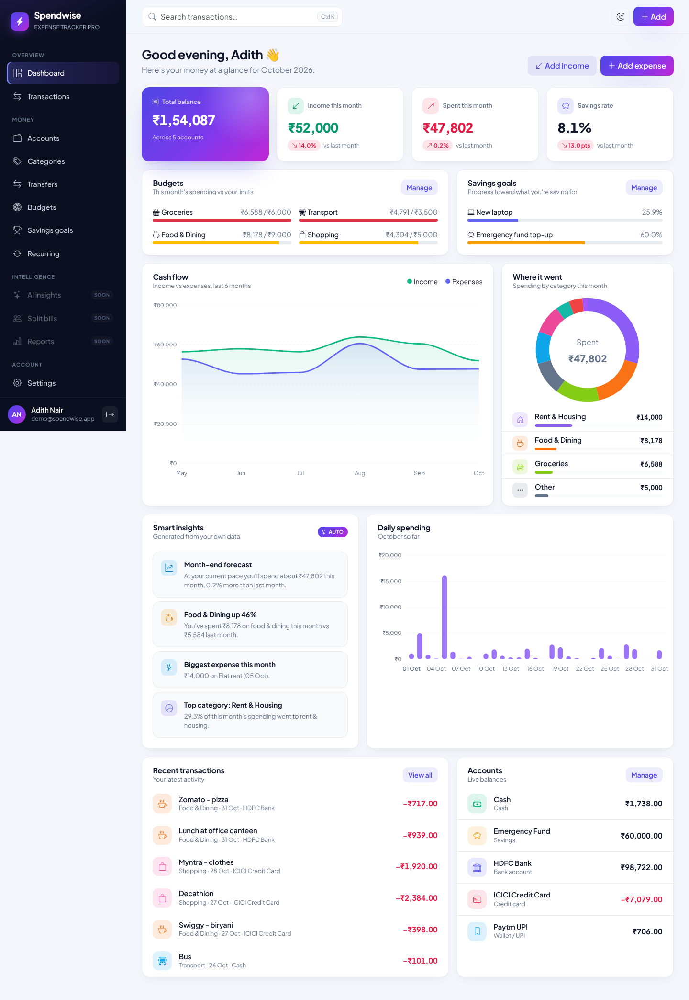

# Spendwise · Cloud-Based Expense Tracker with DevOps Automation

A full-featured personal finance web app (Flask + MySQL) built to be shipped through a
complete DevOps pipeline: GitHub → Jenkins → Docker → Terraform → Ansible → Kubernetes (EKS) → RDS →
Prometheus/Grafana.



## Features

| Area | What it does |
|---|---|
| Dashboard | Total balance, month income/expense with month-over-month change, savings rate, 6-month cash-flow chart, category donut, daily spending chart, budget progress, savings-goal progress, recent activity, live account balances |
| Smart insights | Month-end spending forecast, biggest category movers, largest expense, top category, all computed from the user's own data |
| Transactions | Income and expenses with category, account, payment method, date and notes; quick-add modal on every page (press **N**); edit/delete |
| Search & filters | Text search, type, category, account, payment method, date range, quick periods (this month / last month / this year), filtered totals, pagination |
| Export | Download the current filtered view as CSV |
| Accounts | Bank, cash, cards, wallets and savings with opening balance and live balance; archive instead of delete when history exists |
| Categories | Custom expense and income categories with colour and icon pickers; protected from deletion while in use |
| **Transfers** | Move money between your own accounts without it counting as income or spending; shows as a linked pair of transactions |
| **Budgets** | Monthly spending limit per category with a live progress bar and colour-coded alerts (on track / close / over) |
| **Savings goals** | Named targets with a progress bar; add or withdraw funds; auto-archives when reached |
| **Recurring transactions** | Templates (rent, salary, subscriptions) that auto-generate real transactions on a weekly/monthly/yearly schedule — generated lazily on dashboard load, or via `flask process-recurring` for a scheduler/CronJob |
| Settings | Profile, currency (INR/USD/EUR/GBP), light/dark theme, password change, recent activity log |
| Security | Hashed passwords, CSRF on every form, rate-limited login/register, open-redirect protection, strict security headers (CSP, X-Frame-Options), per-user data isolation, audit log |
| Ops | `/health/live`, `/health/ready` (DB check), Prometheus `/metrics` with request count, latency and business counters |

Coming next: ML auto-categorisation, natural-language quick add, split bills, PDF reports, REST API with
Swagger, admin panel, 2FA.

## Tech stack

Python 3.12 · Flask 3.1 · SQLAlchemy 2 · Flask-Migrate · Flask-Login · Flask-WTF · Flask-Limiter ·
Bootstrap 5.3 · Alpine.js · ApexCharts · MySQL (SQLite for local dev) · pytest.

All front-end libraries and fonts are **self-hosted** in `app/static/vendor/`, so the app works offline and
inside a private cluster, and the Content-Security-Policy allows only the app's own origin.

## Project structure

```
expense-tracker-pro/
├── app/
│   ├── __init__.py          app factory, metrics, security headers, error pages
│   ├── extensions.py        db, migrate, login, csrf, limiter
│   ├── models/              User, Account, Category, Transaction, Budget, SavingsGoal,
│   │                        RecurringTransaction, AuditLog
│   ├── forms.py             all validated forms
│   ├── cli.py               flask seed-demo, flask create-admin, flask process-recurring
│   ├── modules/             one blueprint per feature
│   │   ├── auth/  dashboard/  transactions/  accounts/  categories/  transfers/
│   │   ├── budgets/  goals/  recurring/  settings/  health/
│   ├── services/            business logic (analytics, transactions, transfers, recurring,
│   │                        onboarding, audit, formatting)
│   ├── templates/           base layout, partials, one folder per module
│   └── static/              css design system, js, vendor libraries, fonts
├── migrations/              Alembic migrations
├── tests/                   pytest suite (49 tests, ~91% coverage)
├── docker/ jenkins/ terraform/ ansible/ k8s/ monitoring/ docs/   (filled in later phases)
├── config.py  wsgi.py  requirements.txt  requirements-dev.txt  .env.example
```

## Run locally (Windows PowerShell)

```powershell
cd E:\Projects\expense-tracker-pro
py -3.12 -m venv .venv
.\.venv\Scripts\Activate.ps1
pip install -r requirements-dev.txt
Copy-Item .env.example .env
flask db upgrade
flask seed-demo
flask run --port 5000
```

Open http://127.0.0.1:5000 and sign in with **demo@spendwise.app / Demo@1234**, or register a new account.

## Useful commands

| Command | Purpose |
|---|---|
| `pytest` | Run the test suite |
| `pytest --cov=app` | Tests with coverage report |
| `flake8` | Lint |
| `flask seed-demo --reset` | Recreate the demo user with fresh data (budgets, goals, recurring included) |
| `flask create-admin` | Create an admin user |
| `flask process-recurring` | Generate any recurring transactions that are due, for every user (also runs automatically on dashboard load; wire this into a scheduler/Kubernetes CronJob in production) |
| `flask db migrate -m "msg"` then `flask db upgrade` | Create and apply a schema migration |

## Configuration

All settings come from environment variables (see `.env.example`). With `DB_HOST` empty the app uses a local
SQLite file; set `DB_HOST`, `DB_USER`, `DB_PASSWORD` and `DB_NAME` to use MySQL or AWS RDS.
